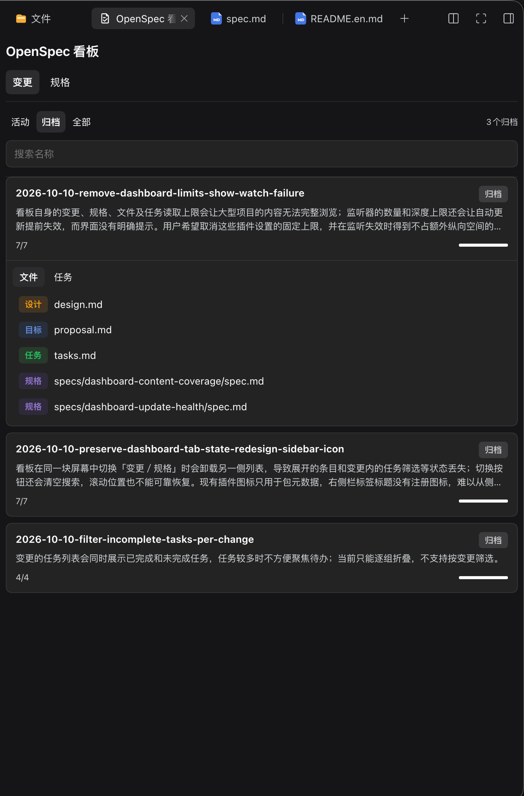
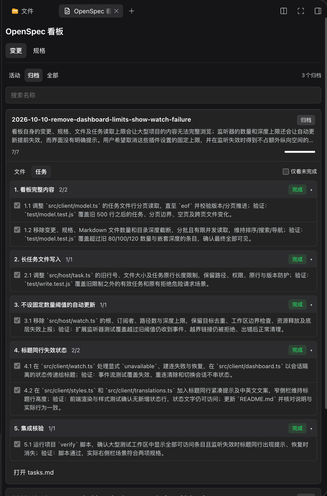

# OpenSpec Dashboard

[简体中文](./README.md) | **English**

View your project's OpenSpec changes, specs, and tasks in the DeepSeek Harness right sidebar.

## What you can do

- **Track changes:** See what's being planned, in progress, done, or archived. Expand a change to view its files and tasks.
- **Work through tasks:** Check off tasks in active changes, or turn on **Incomplete only** to focus on what's left.
- **Find specs:** Browse current specs and their change sources, then open files in DeepSeek Harness.
- **Pick up where you left off:** Search or switch between changes and specs without losing your filters, expanded items, and scroll position in the current session. The dashboard updates when project files change.

## Install and use

For the DeepSeek Harness desktop app:

```sh
dsh plugin --profile desktop add github:vowdemon/dsh-openspec-dashboard
```

For a separate `dsh web` instance:

```sh
dsh plugin --profile web add github:vowdemon/dsh-openspec-dashboard
```

Open a project with an `openspec/` directory. In the right sidebar, select **Add tab** → **OpenSpec dashboard**. For `dsh web`, restart the Web service and refresh the page after installing the plugin.

> Standard OpenSpec projects are supported; custom templates and external stores are not. Tasks in archived changes cannot be checked off. Your browsing position is not kept across page reloads. If automatic updates stop, **Updates unavailable** appears beside the title, but you can still view the current content.

## Demo screenshots




